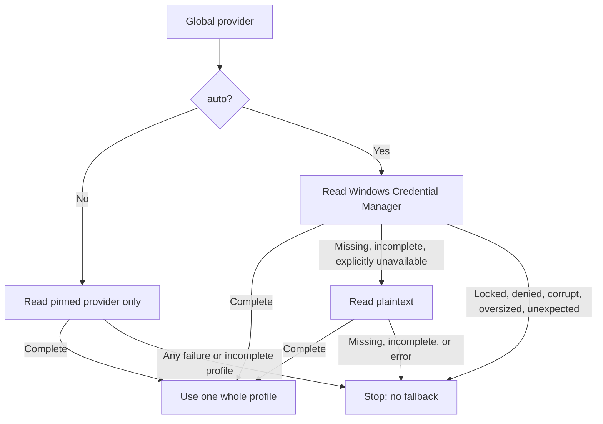

# Profile Credentials

Terminal-managed profiles supply SSH, database, and REST credentials. Runtime reads profiles only; it never writes, migrates, or falls back to inherited environment variables.

Windows 11 is the only supported/tested Windows target. The Linux adapter is retained **unvalidated**; native Linux provisioning is deferred.

## Setup

Follow [README installation](../README.md#installation) for `@ahumandev/autocode`. Its published `autocode-credentials` bin targets `dist/credentials-cli.js` with a Node shebang; the package declares **Node >=20**.

The installed bin requires Node even when installed using Bun. Direct Bun execution bypasses the Node shebang. Keep published `dist/windows-credentials.ps1` beside `dist/credentials-cli.js`.

Use the identity commands below only after checking the running OpenCode identity and logon context.

## Identity Check

1. Confirm the running OpenCode process owner with Windows **Task Manager > Details > User name**, or **Windows Services > relevant service > Properties > Log On**. These are read-only checks, not instructions to change service or logon settings.
2. Provision in a terminal under the actual OpenCode identity **and logon context**. Matching a username or SID alone is insufficient. If the exact context is unavailable, stop and consult the deployment owner; plaintext is not an identity workaround.
3. Run the CLI identity check before provisioning.

`identity` prints `SID` and `Account`, plus a warning: **the same SID does not prove the same logon session**. `CredRead` and `CredWrite` use the current token/logon context. The expected-SID assertion checks SID only, not session equivalence.

### Terminal Commands

With the installed bin and Node >=20:

```powershell
autocode-credentials identity
```

Alternatively, from the **installed package root**, choose **one** direct entry:

```powershell
# Node >=20
node ./dist/credentials-cli.js identity
# Or Bun; bypasses the Node shebang
bun ./dist/credentials-cli.js identity
```

After confirming identity **and logon context**, derive the assertion from the verified terminal:

```powershell
$ExpectedSid = [System.Security.Principal.WindowsIdentity]::GetCurrent().User.Value
```

Subsequent examples use the installed bin. On a Bun-only host, replace `autocode-credentials` with `bun ./dist/credentials-cli.js` from the installed package root, keeping every argument.

## Global Config

Config root is `OPENCODE_CONFIG_DIR`, else `XDG_CONFIG_HOME/opencode`, else `~/.config/opencode`. Merge this top-level shape into global `<root>/autocode.jsonc`:

```jsonc
{
  "credentials": {
    "provider": "auto"
  }
}
```

Use top-level `credentials`; nested `autocode.credentials` is rejected. `autocode.credentials` refers only to internal resolved config, not file schema. Project-level provider overrides are ignored. Accepted global providers are `auto` (default), `windows-credential-manager`, `linux-secret-service`, and `plaintext`.

An explicit provider pins reads to that provider with **zero fallback**, including missing, unavailable, or incomplete profiles. CLI writes accept only `windows-credential-manager` or `plaintext`, never `auto`.

Plaintext storage is fixed at `<root>/credentials/profiles.json`. Arbitrary storage paths and helpers are not supported; workspace/Git storage paths are rejected.

## Terminal Provisioning

Never put secret values in CLI arguments, model prompts, logs, or shell history. Do not dump environment variables or ask AI to read existing credentials. Examples below contain synthetic, non-secret data only.

`set` and `import-env` require `--provider`, `--kind`, `--key`, and `--expected-sid`. Provider must be `windows-credential-manager` or `plaintext`; kind must be `ssh`, `db`, or `rest`. Windows requires the expected-SID assertion for **both native and plaintext writes**. Unknown or duplicate flags are rejected.

IDs are trimmed and uppercased. SSH converts `-` to `_`; DB and REST reject hyphens. Remaining characters must be ASCII letters, digits, or underscore.

Both commands **replace the selected whole profile**, rather than patching fields. Unrelated plaintext profiles are preserved. No automatic writes, copying, or migration occurs.

### Hidden Prompts and Stdin

Default `set` prompts hide **all field inputs**, not only passwords. A blank prompt omits the field. For a synthetic SSH profile, enter `example.invalid` for `host`:

```powershell
autocode-credentials set --provider windows-credential-manager --kind ssh --key DEMO --expected-sid $ExpectedSid
```

`set --stdin` accepts raw profile JSON, **not an envelope**. Input must be strict UTF-8, at most **65536 bytes**, with strings for every provided value and no unknown fields:

```powershell
'{"host":"example.invalid"}' | autocode-credentials set --provider windows-credential-manager --kind ssh --key DEMO --expected-sid $ExpectedSid --stdin
```

Stdin preserves explicit empty strings. For REST, raw JSON `{"authorization":""}` with `--kind rest` expresses an explicitly empty Authorization value; the hidden prompt cannot express it. The stdin cap does not override the smaller native envelope cap.

### Import Existing Shell Variables

Run `import-env` only in the explicitly chosen invoking shell that already holds the intended variables. It accepts the same flags as `set`, except **no `--stdin`**:

```powershell
autocode-credentials import-env --provider windows-credential-manager --kind ssh --key DEMO --expected-sid $ExpectedSid
```

It reads only existing exact `AUTOCODE_<KIND>_<NORMALIZED_ID>_<FIELD>` names for the selected profile, such as `AUTOCODE_SSH_DEMO_HOST`. Kind and field suffixes are uppercase:

| Kind | Field suffixes |
| --- | --- |
| `SSH` | `HOST`, `USERNAME`, `PORT`, `KEYFILE`, `AGENT`, `PASSWORD`, `KEYPASS` |
| `DB` | `CONNECTION`, `USERNAME`, `PASSWORD` |
| `REST` | `AUTHORIZATION`, `USERNAME`, `PASSWORD` |

Missing variables are omitted; explicit empty strings are preserved. Import never clears old environment variables. Runtime does not inherit them as a credential fallback.

## Fields and Auth

Raw JSON field names are lowercase. Every provided value must be a string; unknown fields are rejected.

| Kind | Raw fields | Required |
| --- | --- | --- |
| `ssh` | `host`, `username`, `port`, `keyfile`, `agent`, `password`, `keypass` | Nonblank `host` |
| `db` | `connection`, `username`, `password` | Nonblank `connection` |
| `rest` | `authorization`, `username`, `password` | `authorization` present, or both `username` and `password` present; empty strings are valid |

**SSH:** Username defaults to `root`. Port precedence is explicit `port`, then host-embedded port, then `22`; ports must contain digits only and be within `1..65535`. A readable `keyfile` wins over password, then agent. `keypass` is the private-key passphrase; `keyfile` remains a filesystem path, not key content.

**DB:** Leading `jdbc:` is stripped from the connection. Optional username/password values are trimmed; blanks are omitted.

**REST:** A caller-supplied `Authorization` header, matched case-insensitively, bypasses the profile even when empty. Otherwise, profile `authorization` wins verbatim, including an empty string; otherwise Basic auth uses UTF-8 `username:password`. Omitting `rest_key` permits an unauthenticated request.

## Resolution

Runtime selects **exactly one whole profile from one provider**, never a field-by-field merge. In Windows 11 `auto` mode, native lookup falls back to plaintext only when missing, incomplete, or explicitly unavailable. Locked, denied, corrupt, oversized, and unexpected failures are hard errors, never downgrade triggers.

Windows 11 resolver flow:



When plaintext is active, runtime emits a safe notice without credential values. Explicit provider selection never falls back on any failure.

## Storage Limits

Windows native storage caps the **full serialised envelope at 2560 UTF-8 bytes**. Unicode changes byte count; data is never truncated. The 65536-byte stdin allowance does not increase this cap.

For a larger profile, consciously pin global `credentials.provider` to `plaintext`, then provision or import with `--provider plaintext` under the same verified identity and logon context. There is no automatic copy or migration.

Plaintext is **UNENCRYPTED**, stored only at `<root>/credentials/profiles.json`, with a **1 MiB whole-store cap**. On Windows, a current-SID-only ACL protects the file. Do not edit the store manually or bypass its ACL.

Native at-rest protection does not protect credentials from compromised code running under the same account. Plaintext does not bypass identity or logon-context requirements.

## Troubleshooting and Support

| Symptom | Check or action |
| --- | --- |
| SID assertion fails, or terminal write is not visible to OpenCode | Recheck actual process owner and logon context. Matching SID is insufficient; stop and consult the deployment owner if the exact context is unavailable. |
| Installed bin cannot find Node | Use Node >=20, or direct Bun execution from the installed package root. Bun installation alone does not change the bin's Node shebang. |
| Windows helper missing | Keep published `dist/windows-credentials.ps1` adjacent to `dist/credentials-cli.js`. |
| Config seems ignored | Use top-level `credentials.provider` in global `autocode.jsonc`, not nested `autocode.credentials` or a project override. |
| Environment variables exist but runtime cannot find a profile | Run explicit terminal `import-env` under the verified context; runtime never falls back to inherited environment variables. |
| Pinned provider is missing, unavailable, or incomplete | Provision that provider; pinning means zero fallback. Locked, denied, corrupt, oversized, or unexpected errors must not trigger downgrade. |
| Native envelope exceeds 2560 UTF-8 bytes | Deliberately pin plaintext and provision/import there; no truncation, automatic migration, or ACL bypass. |
| Input rejected | Check normalised ID rules, exact flags, allowed fields, string values, required fields, and byte limits. |

Support reports should contain command name, provider, kind, profile ID, sanitised error text, and identity/logon-check status only. Exclude credential values, raw profiles, and environment dumps. Linux adapter remains unvalidated; native Linux provisioning is deferred.
