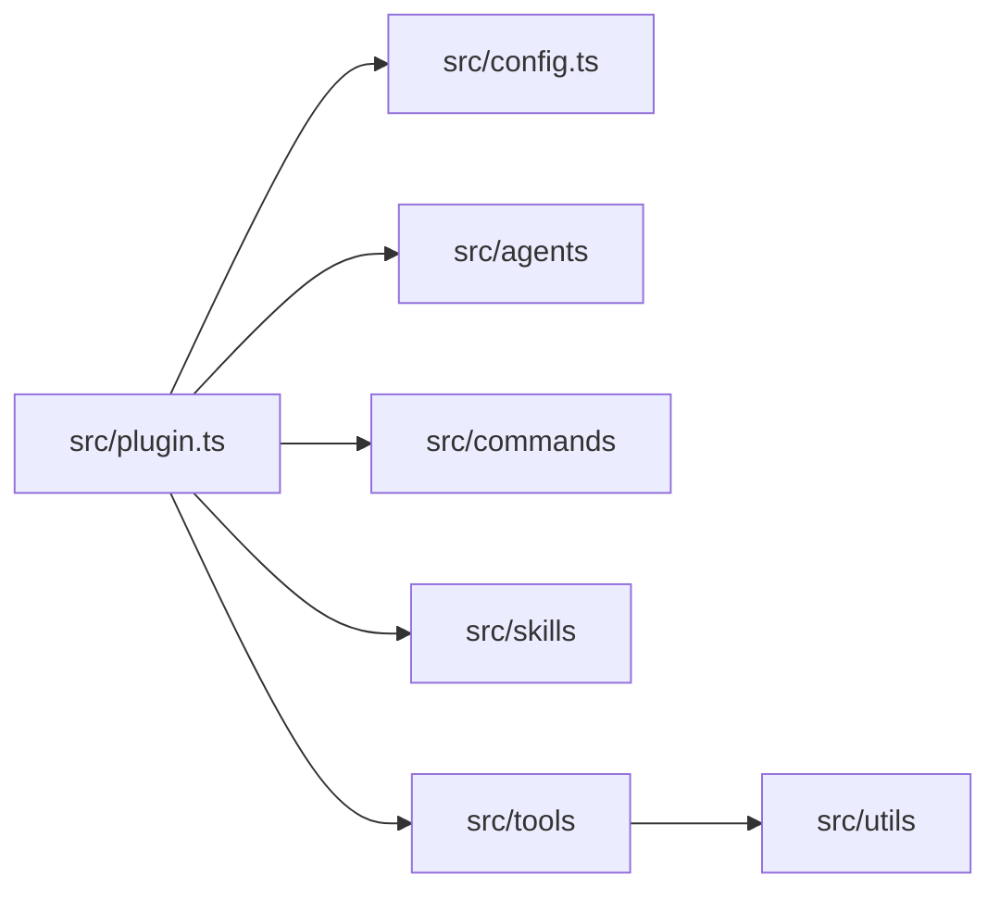

# Development

AutoCode is a TypeScript OpenCode plugin/library. The plugin entry point is [`src/plugin.ts`](../src/plugin.ts), which injects generated skills, loads configuration, derives external-directory permission rules, merges tier-specific agent model settings, registers managed agents, registers managed commands, and exposes runtime tools.



The managed agent catalogue lives in [`src/agents/index.ts`](../src/agents/index.ts), and prompt templates live under [`src/agents/prompts/`](../src/agents/prompts/). Commands are registered in [`src/commands/index.ts`](../src/commands/index.ts), so the published package does not need separate command Markdown files. Generated skills are bundled from source during builds, and [`scripts/copy-skill-sources.ts`](../scripts/copy-skill-sources.ts) copies them into `dist/skills`.

`spy` is registered only with an explicitly configured `spy` tier; `balanced` does not enable it, and `auto` requires an explicitly configured `smart` tier. `spy` is a primary, visible, read-only safety review and guidance agent for direct use only; it cannot receive session handoff.

Runtime tools live in [`src/tools/`](../src/tools/). They cover concepts, design workspace read/write, execution handoff, criteria tracking, read-only database discovery and table reads, REST requests and cached response lookup, sandbox operations, cross-project task execution, and session resume support. Shared tool error handling should stay aligned with [`src/utils/tools.ts`](../src/utils/tools.ts) and the agent error rules.

## Session and Temporary Workspace Architecture

OpenCode sessions are sole workflow and state source. `autocode_session_create` requires a nonblank `prompt` and creates an agent handoff session.

Retained tools create or reuse `.agents/jobs/<timestamp>_<session-title-slug>/` on demand through shared utility. This directory holds temporary per-session artifacts only.

## Local memory transition artifacts

The active local-memory store is `.opencode/autocode/memories/`; it starts empty for this transition and runtime creates Markdown `.md` memory files only through `learn`. No legacy import, conversion, or seed is performed.

## Generated skills

Only bundled AutoCode skills from `src/skills` ship with plugin. No remote skill acquisition or snapshot packaging. OpenCode loads `SKILL.md` guidance into agent context.

Runtime extracts missing builtin skills into `~/.agents/skills/autocode/`; existing builtin directories stay untouched. Do not delete or modify external/user skill folders.

### Local skill build and package validation

1. Edit builtin `src/skills/<skill>/SKILL.md` and supporting local assets; retain `name` and `description` frontmatter for skill loading.

2. Build plugin and bundled skills together:

   ```bash
   bun run build
   ```

   [`scripts/copy-skill-sources.ts`](../scripts/copy-skill-sources.ts) copies local release assets into `dist/skills`, excluding TypeScript and test/spec files. [`scripts/skill-bundle.ts`](../scripts/skill-bundle.ts) writes `dist/skills/.bundle-manifest.json` with directory paths, file paths, and SHA-256 digests.

   For asset-only changes after initial build, refresh skills and manifest without rebuilding plugin:

   ```bash
   bun run copy:skills
   ```

3. Validate existing build before local loading or packaging:

   ```bash
   bun run verify:package
   ```

   [`scripts/verify-package-artifacts.ts`](../scripts/verify-package-artifacts.ts) checks `dist/plugin.js`, `dist/plugin.d.ts`, package metadata, and exact skill manifest paths/digests. Expected result: exit code `0`, no errors. Validation does not build missing artifacts.

4. Use watch mode for bundle/declaration rebuilds:

   ```bash
   bun run watch
   ```

   Skills copy once at watch startup, not on later asset edits. After skill edits, rerun `bun run copy:skills` or restart watch; rerun `bun run verify:package` after output completes.

## Managed script execution

When agents lack tools, the build their own tools on the fly to complete their tasks. These node script artifacts live at `.agents/jobs/YYYY-MM-DD_hh-mm-ss_{title_dir}/scripts`. Each `scripts` project root can contain `src/`, `logs/`, `package.json`, `package-lock.json`, `node_modules/`, and `services/`; these artifacts persist until whole-job cleanup. `scripts/src` is the canonical managed `sourceRoot`, fixed by the runtime and never caller input.

Original project remains authoring context; managed Node processes use `scripts` root as current working directory. Node.js 20 or later and npm are required. Run and service-start entries accept filename-only paths such as `task.mjs` or `nested/task.mjs`, relative to fixed `sourceRoot`. They reject `src/`-prefixed entries, absolute paths, backslashes, traversal, symlink escapes, broken symlinks, non-files, and extensions other than `.mjs`. `AUTOCODE_SCRIPT_ROOT` is `scripts` root; `AUTOCODE_WORKSPACE_ROOT` is unchanged.

| Operation or event | Structure, log, and lifecycle behavior |
| --- | --- |
| `autocode_script_project` | Ensures the directory structure, including `logs/`, and programmatically generates or refreshes `AGENTS.md`. Repeated setup preserves existing `scripts/` and `logs/`. |
| `autocode_script_install` | Installs or reconciles dependencies and writes npm reconciliation logs only when reconciliation work occurs. |
| `autocode_script_run` | Runs finite work and writes execution logs, including for failure and timeout. Finite runs clean up on timeout. |
| `autocode_script_service` `start` | Starts long-running work and creates lifecycle logs; `status` and `stop` use the opaque service `run_id`. Stop services when done. |
| Editing a script | Editing `src/*.mjs` alone creates no run log. |

Typical finite workflow:

1. Prepare project with `autocode_script_project`.
2. Install dependencies with `autocode_script_install` using npm registry version, range, or tag specs only.
3. Run with `autocode_script_run` using `entry`, optional string `argv`, and optional `timeout_ms`.

For long-running work, use `autocode_script_service` with `action` `start`, `status`, or `stop`; service runs use opaque `run_id`. Finite runs clean up on timeout. Services have managed ownership and lifecycle cleanup; stop a service when done.

Dependencies inherited from ancestor workspaces are resolved there; local dependencies install under script `node_modules/`. Dependency specs allow npm registry versions, ranges, and tags only. They reject `file:`, `link:`, relative or absolute paths, URLs, Git sources, and filesystem or network archive sources. Provenance metadata records dependency source and, where applicable, version, path, workspace, and requested range. npm cache reuse may avoid downloads, but does not mean installed `node_modules` files are inherited or shared.

Finite runs start a direct Node process; timeout terminates its process group, and complete output is stored under script `logs/`. Services are Linux-only and have opaque `run_id` values, owner process-group state under `services/`, and validated status and stop operations. Callers should explicitly stop services. Terminal events, disposal, and whole-job cleanup stop services owned by that lifecycle.

## Sandbox execution

Linux sandbox execution requires usable [Bubblewrap](https://github.com/containers/bubblewrap) (`bwrap`).

Sandbox tools include `autocode_sandbox_create`, `autocode_sandbox_cli`, `autocode_sandbox_delete`, `autocode_sandbox_read`, `autocode_sandbox_glob`, `autocode_sandbox_grep`, `autocode_sandbox_edit`, and `autocode_sandbox_copy`. Sandboxes expose `/sandbox` for writable work, `/home` for the sandbox home, and `/workspace` as a read-only project mount.

Canonical sandbox path is exactly `.agents/jobs/YYYY-MM-DD_hh-mm-ss_{title_dir}/sandboxes/{sandbox_name}`. Resolve current job first from its linked session; otherwise use deterministic newest timestamped workspace matching current session-title slug. No owner returns an error before filesystem mutation or process spawn. All sandbox access, list, create, copy, and delete operations stay in resolved current job; never look up sandbox names across jobs, so same `{sandbox_name}` may exist independently in multiple jobs. Never access, fall back to, migrate, scan, delete, or write legacy `.agents/sandboxes`; legacy data remains untouched and inaccessible.

Process kill scans exclude canonical sandbox trees for valid job workspaces; they still scan all other job-workspace files. Cleanup may remove an empty workspace `sandboxes` directory, never its job workspace.

Unsupported hosts include macOS, Windows, Android or Termux, non-Linux systems, and Linux systems without usable `bwrap` or user namespace support. When sandboxing is unsupported, AutoCode disables the sandbox execution agent and force-denies sandbox create, CLI, delete, read, glob, grep, edit, and copy tools.

## Local setup

Local setup targets repository development, not public npm installation.

1. Install repository dependencies needed for build:

   ```bash
   bun install
   ```

   Dependency versions come from [`package.json`](../package.json).

2. Build and validate local plugin before loading:

   ```bash
   bun run build
   bun run verify:package
   ```

   Build clears `dist`, bundles [`src/plugin.ts`](../src/plugin.ts), emits declarations, and copies bundled local skills into `dist/skills` with `.bundle-manifest.json`. Expected outputs: `dist/plugin.js`, `dist/plugin.d.ts`, and validated skill assets. Build does not install shim.

3. Install local shim so OpenCode loads repository build:

   ```bash
   bun run install:shim
   ```

   Shim path: `~/.config/opencode/plugins/autocode.js`.

4. Load plugin in OpenCode. Repository-local [`.opencode/plugins/autocode.ts`](../.opencode/plugins/autocode.ts) re-exports `dist/plugin.js`; build must exist first.

## Development commands

| Command | Purpose |
| --- | --- |
| `bun run build` | Clears `dist`, bundles plugin, emits declarations, copies bundled local skills, writes manifest. |
| `bun run copy:skills` | Refreshes `dist/skills` and `.bundle-manifest.json` from local sources only. |
| `bun run verify:package` | Validates plugin artifacts, package metadata, and skill manifest paths/SHA-256 digests. |
| `bun run install:shim` | Installs local development shim at `~/.config/opencode/plugins/autocode.js`. |
| `bun run watch` | Copies skills/manifest once; watches plugin bundle and declarations. Skill edits require recopy or restart. |
| `bun run test` | Runs TypeScript checking, then isolated Bun tests under `src`. |
| `bun run tests` | Runs isolated Bun tests under `src` without TypeScript checking. |
| `bun run typecheck` | Runs TypeScript checking without emitting files. |
| `bun run verify:sandbox-online` | Runs sandbox verification script. |

There is no `lint` script in the current `package.json`.

## Testing

1. Check types and local runtime/bundled-skill tests together before committing:

   ```bash
   bun run test
   ```

   Uses `bun run typecheck` followed by `bun test src --isolate --reporter=dots`. Expected result: no type diagnostics, passing Bun summary.

2. Run tests alone when type checking already completed:

   ```bash
   bun run tests
   ```

3. Check types alone for quick diagnostics:

   ```bash
   bun run typecheck
   ```

   Success exits `0` with no diagnostics. Built skill assets require separate `bun run build` and `bun run verify:package` checks above.

## Local Plugin Deployment

Local source workflow only; not npm publish or public npm installation.

1. Build and validate distributable output before local deployment:

   ```bash
   bun run build
   bun run verify:package
   ```

   Outputs: `dist/plugin.js`, declarations, bundled local skills under `dist/skills`, and `dist/skills/.bundle-manifest.json`. Package entry points match `main`, `types`, and `exports` in `package.json`.

2. Install shim separately so OpenCode loads local build:

   ```bash
   bun run install:shim
   ```

   Shim path: `~/.config/opencode/plugins/autocode.js`.

See [Distribution Guide](distribution.md) for public registry distribution.
